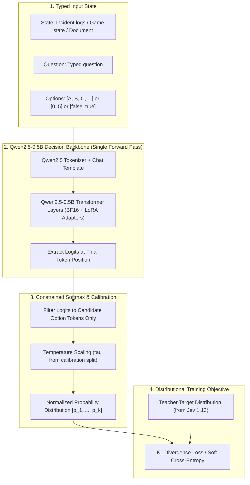

# Implementation Plan: Distilling Qwen2.5-0.5B into a Calibrated System One Decision Model

## Goal Description
Build, fine-tune, calibrate, and benchmark a fast, native **System One decision model** ("Nirnay") powered by **Qwen2.5-0.5B**, trained on the 741,000-row **`SargeDev/jev-distill-corpus-v3`** dataset. 

Unlike conventional autoregressive LLMs that generate token-by-token reasoning text, this model will operate in a **single forward pass**, consuming an environment `state`, a typed `question`, and candidate `options`, and returning a **calibrated probability distribution** across the three core decision primitives:
1. `noul`: Binary verifications (`[P(false), P(true)]`)
2. `choice`: Multi-choice categorical decisions across arbitrary options (`[P(opt_1), ..., P(opt_k)]`)
3. `score`: Ordinal ratings on a discrete `0..5` scale (`[P(0), ..., P(5)]`)

The system will run locally on the user's **NVIDIA GeForce RTX 4050 Laptop GPU (6 GB VRAM)** with native BF16 acceleration and sub-20ms inference latency.

---

## User Review Required

> [!IMPORTANT]
> **Training Time vs. Dataset Size**: The training pool (`train.jsonl`) contains **655,806 rows**. Full-epoch training on an RTX 4050 laptop GPU takes approximately 2.5–3 hours per epoch. The plan establishes a two-phase training protocol:
> 1. **Phase 1 (Pilot Verification)**: Train on a stratified 25,000-row slice (~10 minutes) to verify pipeline integrity, loss convergence, and memory footprint.
> 2. **Phase 2 (Production Distillation)**: Train on the full dataset or a high-density 150k slice with automatic checkpointing and early stopping.

> [!TIP]
> **Zero Quantization Overhead**: Because `Qwen2.5-0.5B` is only 490M parameters (~0.98 GB in BF16), we do not need 4-bit quantization (QLoRA). We can train with **clean 16-bit LoRA (BF16)**. This avoids 4-bit dequantization latency, retains maximum numerical precision, and only consumes ~2.2 GB of your 6 GB VRAM!

---

## Architecture & Technical Design



### Mathematical Formulation
For any sample with $K$ candidate options, let the model's unnormalized logits at the decision token position for option $k \in \{1, \dots, K\}$ be $z_k$.
The predicted probability distribution is:
$$\hat{y}_k = \frac{\exp(z_k / \tau)}{\sum_{j=1}^K \exp(z_j / \tau)}$$
where $\tau$ is the temperature parameter (fixed to $\tau=1.0$ during training and optimized post-hoc on the `calibration` split).

The training objective is the Kullback-Leibler (KL) divergence from the teacher distribution $y$ to the student distribution $\hat{y}$:
$$\mathcal{L}_{\text{distill}} = D_{\text{KL}}(y \parallel \hat{y}) = \sum_{k=1}^K y_k \left( \log y_k - \log \hat{y}_k \right)$$

For ordinal `score` primitives ($0..5$), we additionally support the **Ranked Probability Score (RPS)**:
$$\mathcal{L}_{\text{RPS}} = \frac{1}{K-1} \sum_{i=1}^{K-1} \left( \sum_{k=1}^i y_k - \sum_{k=1}^i \hat{y}_k \right)^2$$

---

## Open Questions

> [!NOTE]
> 1. **Option Formatting Strategy**: The plan uses lettered option tokens (`A`, `B`, `C`, `D`, `E`, `F`) mapped to the options list, which provides the most consistent next-token logit extraction across dynamic options. (For `noul`, options are `A: false`, `B: true`).
> 2. **Target Checkpoint**: Would you prefer the final distilled model saved as standalone merged weights (FP16 `.safetensors` for instant vLLM/Ollama/HuggingFace loading) or as LoRA adapter weights? The plan includes an automated export script that produces both.

---

## Proposed Changes

### Project Layout (`c:\dev\Nirnay`)

```
c:\dev\Nirnay\
├── requirements.txt
├── plan.md
├── src\
│   ├── __init__.py
│   ├── config.py             # Hyperparameters, paths, and model specs
│   ├── schema.py             # Pydantic schemas for noul, choice, score
│   ├── dataset.py            # HuggingFace streaming & prompt tokenization
│   ├── model.py              # Qwen2.5-0.5B wrapper with single-pass logit head
│   ├── loss.py               # Distributional KL-Div and RPS loss functions
│   ├── trainer.py            # Custom PyTorch training & validation loop
│   ├── calibrate.py          # Post-hoc temperature scaling on calibration split
│   ├── evaluate.py           # Evaluation on test_set_30k & ood (Brier, ECE, Accuracy)
│   ├── export.py             # Merge LoRA weights into standalone HF/GGUF model
│   └── infer.py              # Python API & interactive CLI for single-pass decisions
└── scripts\
    ├── train_pilot.py        # 10-minute pilot verification run (25k rows)
    ├── train_full.py         # Full distillation run
    └── run_eval.py           # Benchmark script
```

---

### Component Specifications

#### [NEW] `requirements.txt`
Dependencies ensuring exact versions compatible with the existing CUDA 12.8 + PyTorch 2.11 environment.
```txt
transformers>=4.48.0
datasets>=3.2.0
peft>=0.14.0
accelerate>=1.3.0
scipy>=1.15.0
scikit-learn>=1.6.0
pydantic>=2.10.0
tqdm>=4.67.0
```

---

#### [NEW] `src/config.py`
Centralized configuration with hardware-matched settings for the RTX 4050 (6 GB VRAM).
```python
from dataclasses import dataclass
from typing import Optional

@dataclass
class NirnayConfig:
    # Model
    model_name: str = "Qwen/Qwen2.5-0.5B"
    lora_r: int = 16
    lora_alpha: int = 32
    lora_dropout: float = 0.05
    target_modules: list = ("q_proj", "k_proj", "v_proj", "o_proj", "gate_proj", "up_proj", "down_proj")
    
    # Dataset
    dataset_name: str = "SargeDev/jev-distill-corpus-v3"
    max_seq_len: int = 768
    
    # Training (Optimized for 6 GB VRAM)
    per_device_train_batch_size: int = 8
    gradient_accumulation_steps: int = 4   # Effective batch size = 32
    learning_rate: float = 2e-4
    weight_decay: float = 0.01
    warmup_ratio: float = 0.05
    num_train_epochs: int = 1
    bf16: bool = True
    gradient_checkpointing: bool = True
    
    # Output
    output_dir: str = "checkpoints/nirnay-0.5b"
    log_every_n_steps: int = 50
    eval_every_n_steps: int = 500
```

---

#### [NEW] `src/dataset.py`
Loads `SargeDev/jev-distill-corpus-v3` splits, formats prompts according to Qwen chat syntax, and extracts candidate option token IDs for logit alignment.
* Handles the three primitives:
  * `noul`: `["false", "true"]` $\to$ `A: false`, `B: true`
  * `score`: `["0", "1", "2", "3", "4", "5"]` $\to$ `A: 0`, `B: 1`, ... `F: 5`
  * `choice`: `options` $\to$ `A: opt_1`, `B: opt_2`, ...
* Computes aligned padding masks and target probability tensors.

---

#### [NEW] `src/loss.py`
Implements distribution-aware loss functions:
```python
import torch
import torch.nn as nn
import torch.nn.functional as F

class DistillationLoss(nn.Module):
    """Kullback-Leibler divergence with optional Ranked Probability Score for ordinal scores."""
    def __init__(self, rps_weight: float = 0.5):
        super().__init__()
        self.rps_weight = rps_weight

    def forward(self, logits: torch.Tensor, targets: torch.Tensor, kind: str = "choice") -> torch.Tensor:
        # logits: (batch_size, num_options)
        # targets: (batch_size, num_options) - normalized probabilities summing to 1.0
        log_probs = F.log_softmax(logits, dim=-1)
        kl = F.kl_div(log_probs, targets, reduction="batchmean")
        
        if kind == "score" and self.rps_weight > 0:
            probs = torch.softmax(logits, dim=-1)
            cum_pred = torch.cumsum(probs, dim=-1)
            cum_target = torch.cumsum(targets, dim=-1)
            rps = torch.mean((cum_pred - cum_target) ** 2)
            return kl + self.rps_weight * rps
            
        return kl
```

---

#### [NEW] `src/model.py`
Wraps `Qwen2.5-0.5B` with PEFT LoRA and implements the non-autoregressive decision head:
* Takes input token IDs and option token index masks.
* Performs **one single forward pass**.
* Slices logits at the final position `[:, -1, option_token_ids]`.
* Returns unnormalized decision logits and softmax probabilities.

---

#### [NEW] `src/calibrate.py`
Performs temperature scaling optimization using the dedicated `calibration` split (13,766 rows):
* Optimizes $\tau$ to minimize Negative Log Likelihood / KL Divergence.
* Computes pre- and post-calibration **Expected Calibration Error (ECE)** and **Brier Score**.
* Saves the fitted temperature scalar `calibration_params.json` for runtime inference.

---

#### [NEW] `src/evaluate.py`
Standardized evaluation against the official held-out benchmark splits:
* Evaluates on **`test_set_30k`** (29,955 rows) and **`ood`** (13,058 rows).
* Reports:
  * **Brier Score** (Mean Squared Error between predicted probabilities and target distribution)
  * **Expected Calibration Error (ECE)** (across 10 reliability bins)
  * **Top-1 Decision Accuracy**
  * **Latency (ms per decision)** on RTX 4050.

---

#### [NEW] `src/infer.py`
A clean Python inference API and interactive CLI tool:
```python
from src.infer import NirnayEngine

engine = NirnayEngine.from_pretrained("checkpoints/nirnay-0.5b-calibrated")
decision = engine.decide(
    state="The log shipper shows a 22% drop in request rate with 500 status codes spiking on node 4.",
    question="Should automated traffic failover be triggered immediately?",
    options=["false", "true"],
    kind="noul"
)
print(decision.probabilities) # e.g., {"false": 0.08, "true": 0.92}
print(decision.latency_ms)    # e.g., 14.2 ms
```

---

## Verification Plan

### Automated Tests
1. **Model & Forward Pass Smoke Test**:
   ```powershell
   python -m unittest tests/test_model.py
   ```
   * Verifies batch shape, single forward pass, logit extraction, and gradient flow through LoRA.
2. **Loss Function Unit Test**:
   ```powershell
   python -m unittest tests/test_loss.py
   ```
   * Verifies KL divergence with soft targets and RPS ordinal monotonicity.
3. **Pilot Training Run (25k rows)**:
   ```powershell
   python scripts/train_pilot.py
   ```
   * Asserts loss monotonically decreases, VRAM stays below 3.5 GB, and checkpoint saves successfully.

### Benchmark & Validation Gates
* **Memory Check**: Verify with `nvidia-smi` that peak VRAM $\le 3.5\text{ GB}$ (leaving $\ge 2.5\text{ GB}$ safety buffer).
* **Speed Check**: Verify inference throughput exceeds $50\text{ decisions/sec}$ on RTX 4050 ($< 20\text{ ms}$ per decision).
* **Calibration Gate**: Post-calibration ECE on `test_set_30k` must be $< 0.05$ (meaning predicted probabilities deviate from empirical frequencies by less than 5%).
